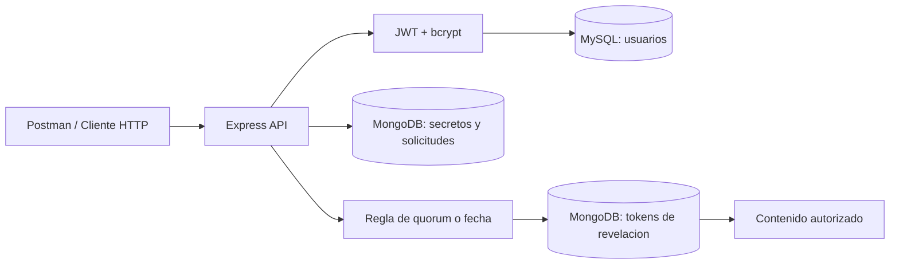

# Arquitectura explicada

## ¿Qué se almacena dónde?

| Componente | Base de datos | Motivo |
| --- | --- | --- |
| `Usuario` | MySQL / Sequelize | Identidad y roles; contraseñas bcrypt |
| `Secreto` | MongoDB / Mongoose | Título, contenido oculto, autor, fecha, solicitudes |
| `TokenRevelacion` | MongoDB / Mongoose | Tokens especiales, uso único y caducidad |

Diagrama para pegar en Mermaid / draw.io:

## Reglas importantes

- Se exige JWT de acceso para **todas** las rutas de secretos, sin excepción para el jefe.
- `POST /auth/registro` asigna el rol `agente`, nunca acepta `rol` desde el cliente.
- `creadoPor`, `userId` y `fecha` se generan desde identidad JWT y reloj del servidor.
- Dos solicitudes del **mismo usuario** cuentan como una, y la actualización es atómica.
- Quórum = al menos **2 identidades distintas**, con solicitudes de los **últimos 5 minutos**.
- El **creador** cuenta si solicita, pero no cuenta automáticamente por crear.
- La apertura por fecha no requiere solicitudes.
- La lista devuelve título, id, fecha y conteos, jamás `contenido`.
- Bonus: el token de revelación caduca en **60 segundos** y un canje atómico marca `usado=true`.
- `JWT_REVEAL_SECRET` es diferente del secreto utilizado para iniciar sesión.

## Advertencias para producción

Este es un proyecto académico: el contenido está como `String` en MongoDB (según el enunciado), **no cifrado en reposo a nivel de aplicación**. En un sistema real sería necesario cifrado con gestión de claves, TLS, políticas de acceso a bases, auditoría, copias de seguridad, rotación de claves, despliegue seguro y observabilidad. No expongas puertos de DB ni el `.env` públicamente.
